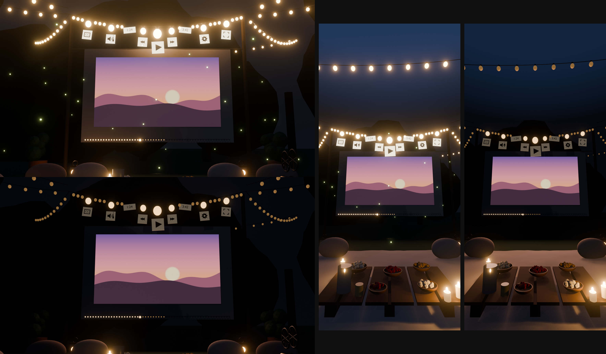

# Picnic Cinema — outdoor video skin

A [Video.js v10](https://videojs.org) skin for React: an outdoor movie night in the garden, modelled in Blender and
rendered with three.js. The video plays on a sheet hung between two posts; the controls hang as paper tags from a string
of festoon bulbs that light up when you pause and dim while the film plays; the timeline is the fairy lights along the
sheet's hem; a corded projector remote on the blanket lifts into a full control panel; fireflies drift out when the
video stays paused; and fullscreen walks the camera up to the screen. Every control is a real Video.js control, so
keyboard, screen readers, tooltips and menus work as usual.



## Run it

```sh
npm install
npm run dev        # the demo: the player alone, filling the page
npm run build      # static build in dist/ (relative URLs, works in a subfolder)
npm run typecheck
```

The demo plays *The Fall of the House of Usher* (1928, public domain) from Mux; change the stream in `demo/main.tsx`.
Pushing to `main` deploys the demo to GitHub Pages (`.github/workflows/pages.yml`; set the repository's Pages source to
"GitHub Actions" once).

## Use it in your app

Copy `src/` into your project (it imports with the `@/` alias for its own folder, or rewrite those imports to relative
paths), add `three`, `@videojs/react` and `@videojs/core`, and wrap your media:

```tsx
import { HlsVideo } from '@videojs/react/media/hls-video';
import { VideoPlayer } from '@videojs/react/video';
import { VideoSkin } from './skin/video/skin';

<VideoPlayer poster={poster}>
  <VideoSkin style={{ width: '100%', aspectRatio: '16 / 9' }}>
    {/* crossOrigin lets WebGL read the video frames for the sheet and its light. */}
    <HlsVideo src={src} playsInline crossOrigin="anonymous" />
  </VideoSkin>
</VideoPlayer>
```

Give the player a portrait shape on phones and the skin switches to its upright framing.

## What's here

- `src/` — the skin (React + CSS on the Video.js Default skin's styles). Start at `src/video/skin.tsx`; the 3D stage is
  `src/video/display/picnic-stage.tsx`.
- `src/assets/picnic-scene.glb` — the scene, exported from Blender.
- `blender/picnic_player.blend` — the Blender scene. Two text blocks inside it:
  - `picnic_states.py` — `apply_state("paused"|"playing")`, `apply_layout("desktop"|"phone")` and
    `apply_remote("rest"|"open", layout)`, used for the design renders.
  - `export_glb.py` — re-exports `src/assets/picnic-scene.glb` (desktop rest pose; icons, text, lights and fireflies are
    left out because the web skin draws those itself).
- `design/renders/` — paused/playing stills, remote stills and the fullscreen push-in test.
- `demo/` — the demo page.

## How it works

`src/video/display/picnic-stage.tsx` loads the GLB, merges the static meshes, plays the video on `VideoScreen`, and lays
every Video.js control over its mesh each frame (projected bounds), so keyboard, focus, tooltips, menus and screen
readers all work on real DOM controls.

- **Bulb strand** — `Tag_<Name>` / `Tag_<Name>_Card` / `Ctrl_<Name>` carry captions, volume, current time, rewind, play,
  forward, duration, settings and fullscreen. Hovered or focused tags brighten their bulb and swing.
- **House lights** — paused: bulbs, tags and garden lights up; playing: they dim and the sheet's light (tinted by the
  video's average colour) takes over. Values are in `LEVELS`.
- **Hem timeline** — the fairy lights `Hem_00…Hem_55` and `Hem_Playhead` follow the time slider laid over `HemWire_mesh`.
- **Fireflies** — drift out after 4 s paused, scatter on play.
- **Remote** — `Remote` (keys `RKey_*`, `RKnob_Volume`, scrubber `RScrubGroove`/`RScrubPlate`). Click it (or its toggle,
  Escape closes) to lift it in front of the camera with the full controls. On desktop it rests on the crate, on phones
  on the table.
- **Fullscreen** — the camera pushes into the sheet (0.85 s), and the remote becomes the control bar, tucking away while
  the video plays and the pointer is idle. `data-picnic-preview-fullscreen` on the player shows this framing without
  the Fullscreen API.
- **Look around** (desktop, mouse/trackpad) — drag sideways to orbit around the sheet (±25°); drag down to look down at
  the blanket and table (up to 38°), up to look up at the bulbs (up to 22°). Zoom like a map with Ctrl/⌘ + scroll or a
  pinch, from stepping back to see the whole garden to close in; plain scrolling scrolls the page and shows a hint. A
  drag never counts as a click. "Reset view" appears once moved, and the camera glides back after 7 s idle. Off in
  fullscreen and on touch. Limits are in `ORBIT`.
- **Layouts** — `data-picnic-layout="desktop"` for landscape players, `"phone"` below a 0.85 width/height ratio
  (portrait camera, bigger tags, remote on the table).
- Reduced motion: no sway, parallax or drift; transitions snap. Without WebGL the Default layout stays.

- **Sky** — a dome of stars that brighten when the house lights go down, and a big crescent moon waiting just above the
  default framing for whoever looks up.

## License

[Apache 2.0](LICENSE).
